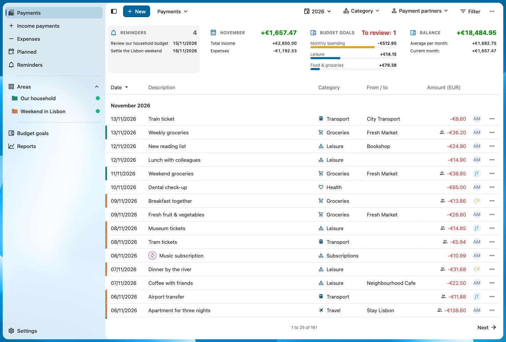
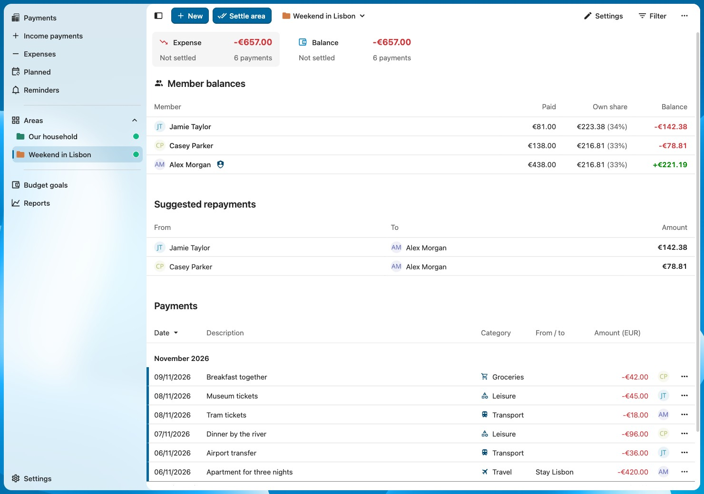
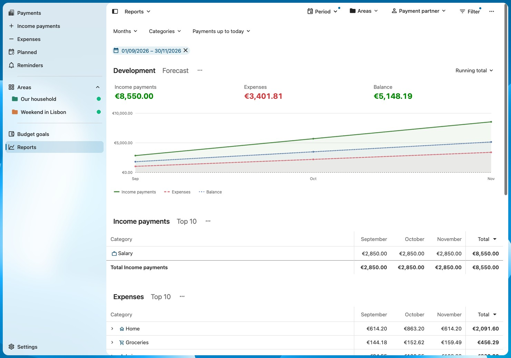
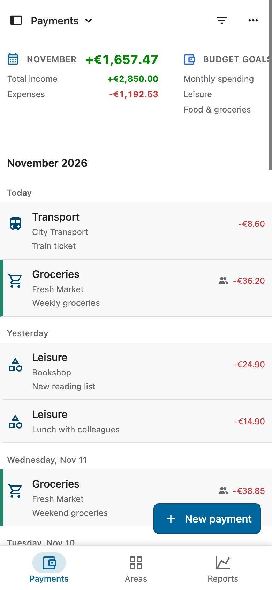
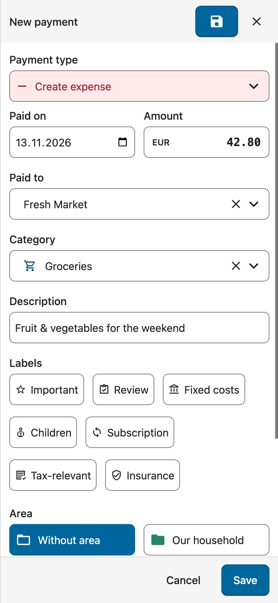

# CoBudget

**English** · [Deutsch](docs/readme.de.md) · [Français](docs/readme.fr.md) · [Español](docs/readme.es.md)

CoBudget combines a personal household budget with shared areas in Nextcloud.
You record income and expenses and, for shared payments, specify who paid and
how the amount is divided. Your personal overview includes your share; the shared
area shows the full payment and what members owe each other.

The web app is designed for smartphones and tablets too. You can record payments directly from your mobile device while on the go.

CoBudget does not connect to bank accounts. Its reports are based on the payments
you record.

[How payments and shares work](docs/concept.md).

## Features

- **Payments:** income, expenses, categories, payment partners, labels and tags.
- **Planning:** recurring payments, budget goals, reports, comparisons and forecasts.
- **Shared areas:** record who paid, choose the split and settle outstanding
  balances. Your personal overview counts your share; shared areas show the total.
- **Receipts and reminders:** store receipts in Nextcloud Files and manage independent
  or payment-linked reminders, including completion and an archive.
- **Notifications:** Nextcloud, a private CoBudget Talk chat and optional
  email, with separate choices for supported events. Reminders can also sync with
  a calendar; private calendar edits sync back to CoBudget.
- **Exports and backups:** print reports, export CSV, copy tables to a spreadsheet and
  create personal exports or administrator backups.
- **Workspaces and appearance:** separate data pools with workspaces, use desktop or mobile
  layouts and choose a light, dark or system appearance.

The interface is available in English, German, French and Spanish.
[Features](FEATURES.md) explains the workflows and limits;
[report calculations](docs/reports.md) explains amounts, forecasts and exports.

## Screenshots

CoBudget 1.0 with fictional sample data. Select an image to enlarge.

<table>
<tr>
<td width="50%" align="center" valign="top">
<strong>Payments and personal shares</strong> 

</td>
<td width="50%" align="center" valign="top">
<strong>Shared expenses and repayments</strong> 

</td>
</tr>
<tr>
<td width="50%" align="center" valign="top">
<strong>Reports</strong> 

</td>
<td width="50%" align="center" valign="top">
<strong>Mobile payment entry</strong> 

</td>
</tr>
</table>

## Requirements

CoBudget requires **Nextcloud 34 or newer**.

Use the PHP version supported by your Nextcloud release (8.2 or newer for 34,
8.3 or newer for 35), a modern browser and working Nextcloud background jobs.
Talk, calendar synchronization and email are optional; email uses the address in
your Nextcloud account and requires configured outgoing mail on the server.

## Install or update

Install CoBudget through Nextcloud's Apps administration from the
[App Store](https://apps.nextcloud.com/apps/cobudget), or use `occ app:install cobudget`.
For manual installation:

1. Download the signed `cobudget.tar.gz` from [GitHub Releases](https://github.com/whollaus/cobudget/releases).
2. Extract it into Nextcloud's `apps/` or `custom_apps/` directory as `cobudget`.
3. Enable the app and complete any pending update.

GitHub's automatic source archives are not installable app packages. Back up your
data before updating. Configure system cron to run Nextcloud's `cron.php` every
five minutes as the web server user. See [Operating CoBudget](docs/operations.md)
for jobs, notifications and recovery.

## What a backup contains

A **personal export** preserves your financial perspective and can be imported
only into an empty CoBudget user state. Shared amounts become independent personal
payments. An **administrator full backup** preserves all CoBudget financial data
and portable user settings; restoring it replaces the app's current data.

**Neither archive contains receipt files.** It stores their paths. Back up the
associated Nextcloud Files with your existing Nextcloud Files backup solution.
Receipt-file backup is deliberately handled there. These archives do not replace a
complete Nextcloud backup. CoBudget temporarily blocks app access during backup and
restore. If an operation is already running, retry once it has finished. Reload open
CoBudget tabs after a restore. See the
[recovery procedure](docs/operations.md#backup-and-recovery).

## Feedback and support

Bug reports and test results help improve CoBudget. CoBudget is
primarily maintained by one person; please discuss code contributions first.
See [CONTRIBUTING.md](CONTRIBUTING.md), [GitHub Issues](https://github.com/whollaus/cobudget/issues)
and the [changelog](CHANGELOG.md). Report suspected vulnerabilities using
[SECURITY.md](SECURITY.md).

Support development through [GitHub Sponsors](https://github.com/sponsors/whollaus)
or [Stripe](https://donate.stripe.com/aFaeVdfARbPNe897bu5J600).

## Development

- [Development guide](docs/development.md): builds and local tests.
- [Architecture](docs/architecture.md): data, permissions, backups and migrations.
- [Design system](docs/design-system.md): UI conventions and verification.
- [Release process](RELEASING.md): packaging and signing.

## License

GNU Affero General Public License v3.0 or later. See [LICENSE](LICENSE).
