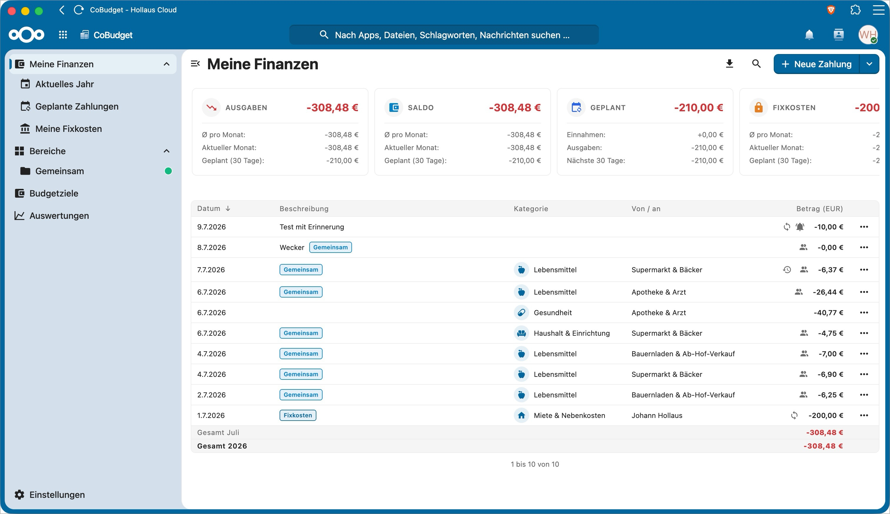
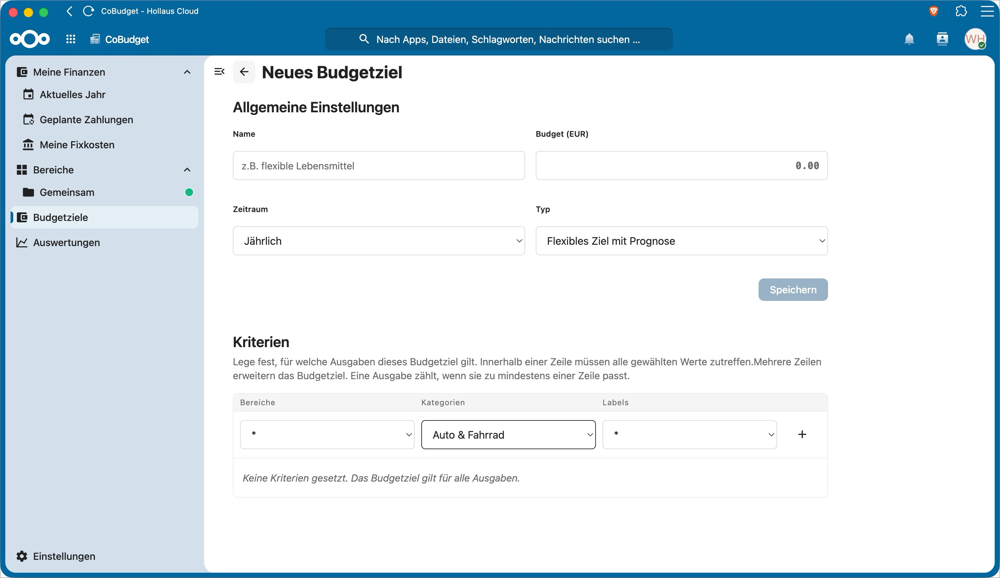
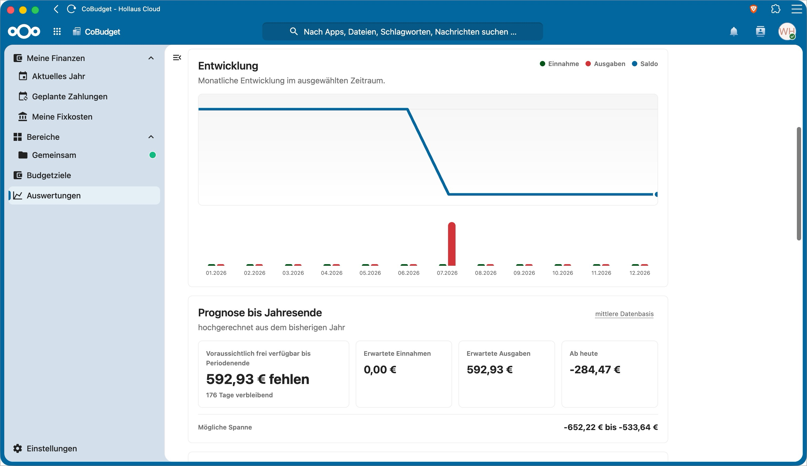
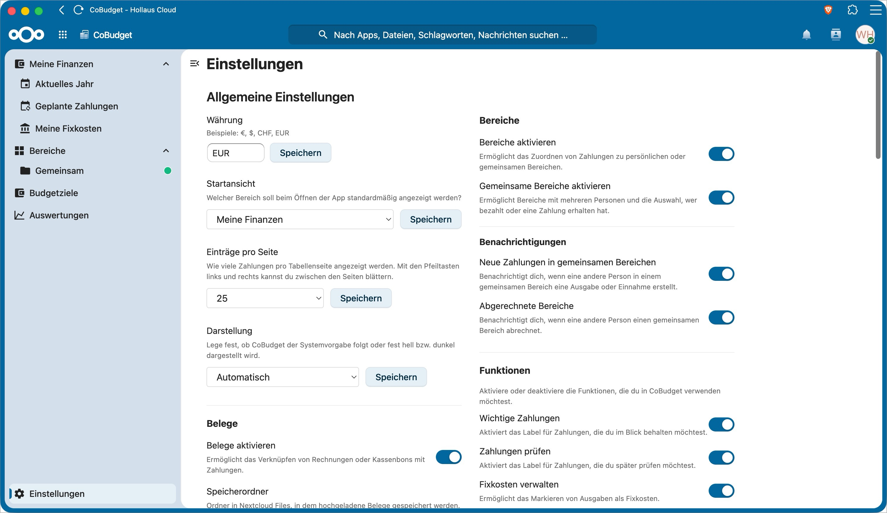

# CoBudget

Personal and shared household budgeting inside Nextcloud. Track income and
expenses, split shared costs, attach receipts and understand your spending while
keeping the data on your own server.

> [!WARNING]
> CoBudget is beta. Keep regular backups, especially before updates, and do not
> use it as the only record of critical financial data. Development is AI-assisted;
> the app has automated tests but has not had an independent security audit.
> See the [security policy](SECURITY.md).

## Status

The current development milestone is **0.8.5 (beta)**, consolidating the rebuild
since 0.7.0. See the [changelog](CHANGELOG.md) for the prepared release notes and
[GitHub Releases](https://github.com/whollaus/cobudget/releases) for published versions.

**1.0.0 is intended to be the first stable release**, with no committed date.
The focus before then is reliable upgrades, backup/restore, shared settlements,
recurring payments and regression checks across supported Nextcloud versions,
mobile layouts, keyboard navigation and themes. Features and data structures may
still change during beta.

## What you can do

- Record income and expenses with categories, payment partners, labels and tags.
- Plan recurring payments; manage independent and payment-linked reminders with notes, completion and an archive. Keep receipts in Nextcloud Files.
- Hide the Reminders interface under Settings → Features while keeping existing notifications and calendar synchronization active.
- Choose Nextcloud and/or private Talk notifications; optionally synchronize reminders with a private calendar in both directions. Deleting a calendar event archives its reminder.
- Organize personal or shared areas, split costs and settle balances.
- Set budget goals and track progress using your personal share.
- Explore reports, comparisons and forecasts; print or export the selected data.
- Separate independent data pools with workspaces.
- Create personal exports and administrator-owned full backups.
- Use desktop/mobile layouts, keyboard shortcuts and light, dark or system appearance.

The interface is available in English, German, French and Spanish.
See the [feature overview](FEATURES.md) for workflows and limits, and
[report calculations](docs/reports.md) for financial scope, forecasts and exports.

## Requirements

- Nextcloud 33, 34 or 35.
- PHP supported by your Nextcloud release: at least 8.2 for 33/34, or 8.3 for 35.
- An account with access to CoBudget and a modern JavaScript-enabled browser.
- Working Nextcloud background jobs for recurrence, reminders and scheduled backups.

See [compatibility checks](tests/README.md#compatibility-ci) for the automated
server matrix and its validation limits.

## Installation

Install or update CoBudget from Nextcloud's Apps administration via the
[official App Store listing](https://apps.nextcloud.com/apps/cobudget).
Administrators can also use `occ app:install cobudget`.

For manual installation:

1. Download the signed `cobudget.tar.gz` asset from [GitHub Releases](https://github.com/whollaus/cobudget/releases).
2. Extract it into Nextcloud's `apps/` or `custom_apps/` directory, keeping the folder name `cobudget`.
3. Enable CoBudget in Nextcloud and complete any pending app update.

GitHub's automatic source archives are repository snapshots, not installable app
packages. Back up existing data before updating.

Configure system cron to run Nextcloud's `cron.php` every five minutes as the web
server user. [Operating CoBudget](docs/operations.md) explains job diagnostics,
optional personal Talk notifications and restore resource limits.

## Feedback and support

**Bug reports are especially welcome.** Feedback and testing are currently more
helpful than additional code contributions. CoBudget is primarily developed by
one maintainer; pull requests require prior agreement. See
[CONTRIBUTING.md](CONTRIBUTING.md) and [GitHub Issues](https://github.com/whollaus/cobudget/issues).
For suspected vulnerabilities, follow [SECURITY.md](SECURITY.md).

You can support development through [GitHub Sponsors](https://github.com/sponsors/whollaus)
or [Stripe](https://donate.stripe.com/aFaeVdfARbPNe897bu5J600).

## Development

- [Development guide](docs/development.md): build, tests and guarded fresh-install reset.
- [Architecture](docs/architecture.md): data, permissions, recurrence, backups and migrations.
- [Design system](docs/design-system.md): shared UI conventions and verification.
- [AGENTS.md](AGENTS.md): central coding-assistant instructions.
- [Release process](RELEASING.md): maintainer packaging and signing.

## Screenshots

Show screenshots from an earlier beta

These illustrate the app's purpose; the current interface has changed substantially.

## License

GNU Affero General Public License v3.0 or later. See [LICENSE](LICENSE).
