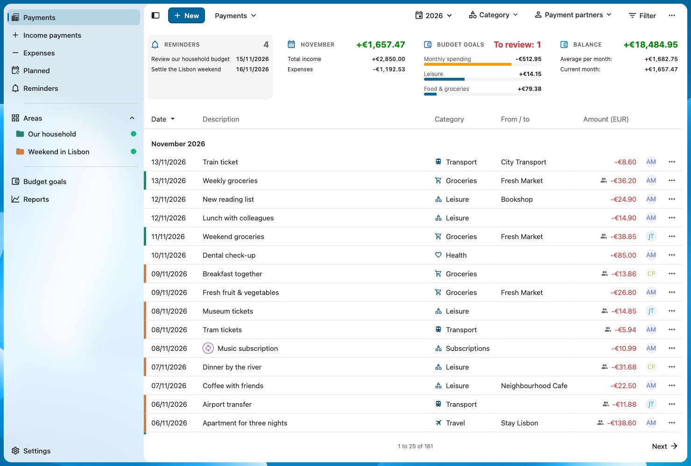
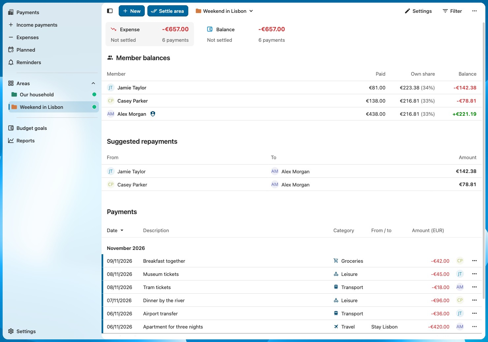
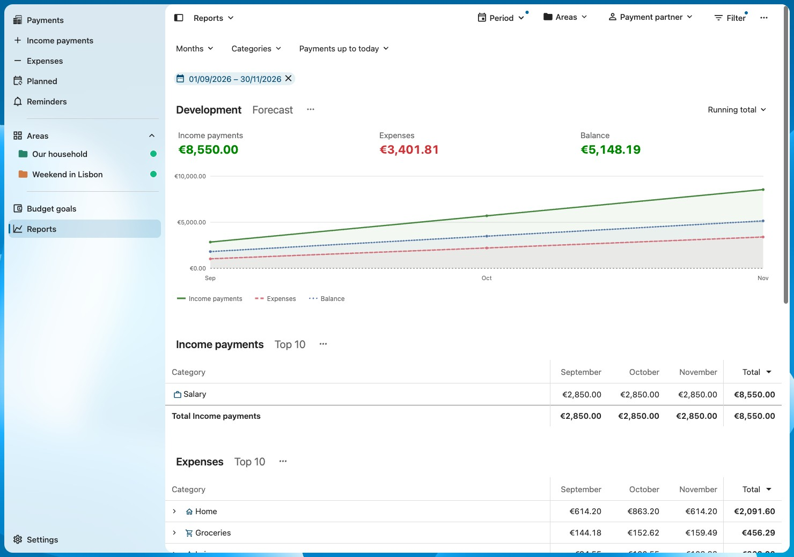
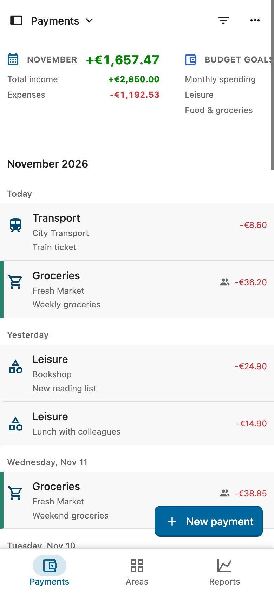
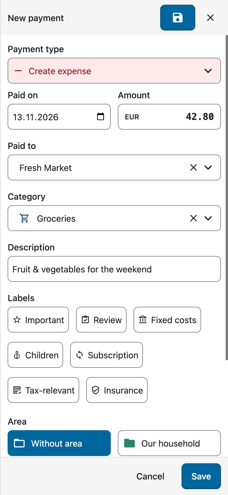

# CoBudget

[English](../README.md) · **Deutsch** · [Français](readme.fr.md) · [Español](readme.es.md)

CoBudget verbindet ein persönliches Haushaltsbuch mit gemeinsamen Bereichen in
Nextcloud. Du erfasst Einnahmen und Ausgaben und legst bei gemeinsamen Zahlungen
fest, wer bezahlt hat und wie der Betrag aufgeteilt wird. Deine persönliche
Übersicht berücksichtigt deinen Anteil; der gemeinsame Bereich zeigt die gesamte
Zahlung und wer wem noch etwas schuldet.

Die Web-App ist auch für Smartphones und Tablets ausgelegt. So kannst du Zahlungen direkt unterwegs erfassen.

CoBudget hat keine Anbindung an Bankkonten. Die Auswertungen beruhen auf den
Zahlungen, die du erfasst.

[Mehr zum Konzept](concept.md).

## Funktionen

- **Zahlungen:** Einnahmen und Ausgaben mit Kategorien, Zahlungspartnern,
  Labels und Tags erfassen.
- **Planung:** wiederkehrende Zahlungen, Budgetziele, Auswertungen, Vergleiche
  und Prognosen nutzen.
- **Gemeinsame Bereiche:** festhalten, wer bezahlt hat, Anteile wählen und offene Salden
  abrechnen. Deine persönliche Übersicht zählt deinen Anteil; der gemeinsame
  Bereich zeigt den Gesamtbetrag.
- **Belege und Erinnerungen:** Belege in Nextcloud Files ablegen und eigene oder
  zahlungsbezogene Erinnerungen verwalten, erledigen und archivieren.
- **Benachrichtigungen:** Nextcloud, privater CoBudget-Chat in Talk und
  optionale E-Mails lassen sich je unterstütztem Ereignis getrennt aktivieren.
  Erinnerungen können mit einem Kalender synchronisiert werden; Änderungen in
  privaten Kalendern werden auch nach CoBudget übernommen.
- **Exporte und Backups:** Berichte drucken, CSV exportieren, Tabellen in eine
  Tabellenkalkulation kopieren und persönliche Exporte oder Admin-Backups erstellen.
- **Workspaces und Darstellung:** getrennte Datenbestände mit Workspaces, mobile und
  Desktop-Ansicht sowie helles, dunkles oder Systemdesign.

Die Oberfläche ist auf Deutsch, Englisch, Französisch und Spanisch verfügbar.
Die weiterführende technische Dokumentation ist auf Englisch:
[Funktionsübersicht](../FEATURES.md), [Auswertungen](reports.md) und
[Konzept von CoBudget](concept.md).

## Screenshots

CoBudget 1.0 mit fiktiven Beispieldaten. Zum Vergrößern auf ein Bild klicken.

<table>
<tr>
<td width="50%" align="center" valign="top">
<strong>Zahlungen und persönliche Anteile</strong> 

</td>
<td width="50%" align="center" valign="top">
<strong>Gemeinsame Ausgaben und Ausgleichszahlungen</strong> 

</td>
</tr>
<tr>
<td width="50%" align="center" valign="top">
<strong>Auswertungen</strong> 

</td>
<td width="50%" align="center" valign="top">
<strong>Mobile Zahlungserfassung</strong> 

</td>
</tr>
</table>

## Voraussetzungen

CoBudget setzt **Nextcloud 34 oder neuer** voraus.

Benötigt werden eine passende PHP-Version (ab 8.2 für Nextcloud 34, ab 8.3 für 35),
ein moderner Browser und funktionierende Nextcloud-Hintergrundaufgaben. Talk,
Kalender und E-Mail sind optional. E-Mails gehen an die Adresse im Nextcloud-Konto;
der Server muss für den Mailversand eingerichtet sein.

## Installation und Updates

Installiere CoBudget über die App-Verwaltung aus dem
[Nextcloud App Store](https://apps.nextcloud.com/apps/cobudget).
Administratoren können auch `occ app:install cobudget` verwenden.
Für die manuelle Installation:

1. Die signierte Datei `cobudget.tar.gz` aus den [GitHub Releases](https://github.com/whollaus/cobudget/releases) herunterladen.
2. Als Ordner `cobudget` nach `apps/` oder `custom_apps/` der Nextcloud entpacken.
3. Die App aktivieren und ein eventuell anstehendes Update abschließen.

Die automatisch von GitHub erzeugten Quellcodearchive sind keine installierbaren
App-Pakete. Vor Updates ein Backup erstellen. Nextclouds `cron.php` sollte alle fünf
Minuten als Webserver-Benutzer laufen. Details stehen im [Betriebshandbuch](operations.md).

## Was wird gesichert?

Ein **persönlicher Export** bewahrt deine eigene finanzielle Sicht. Er lässt sich
nur in einen leeren CoBudget-Benutzerbestand importieren; gemeinsame Anteile werden
dabei eigenständige persönliche Zahlungen. Ein **Admin-Vollbackup** enthält alle
CoBudget-Finanzdaten und übertragbare Benutzereinstellungen. Seine Wiederherstellung
ersetzt den aktuellen Datenbestand der App.

**Belegdateien sind in keinem der Archive enthalten, nur ihre Pfade.** Sichere die
zugehörigen Dateien mit deiner vorhandenen Backup-Lösung für Nextcloud Files.
Die Belegsicherung bleibt bewusst deren Aufgabe. Die Archive ersetzen kein
vollständiges Nextcloud-Backup. Während Backup und Restore sperrt CoBudget den
App-Zugriff vorübergehend. Läuft noch ein Vorgang, starte die Sicherung oder
Wiederherstellung danach erneut. Lade offene CoBudget-Tabs nach einem Restore neu.
Siehe [Wiederherstellung](operations.md#backup-and-recovery).

## Rückmeldungen und Unterstützung

Fehlermeldungen und Testergebnisse helfen bei der Weiterentwicklung. CoBudget wird
hauptsächlich von einer Person gepflegt; Codebeiträge bitte vorher absprechen.
[GitHub Issues](https://github.com/whollaus/cobudget/issues) · [Mitwirken](../CONTRIBUTING.md) ·
[Änderungen](../CHANGELOG.md) · [Sicherheitsprobleme melden](../SECURITY.md).

Entwicklung unterstützen: [GitHub Sponsors](https://github.com/sponsors/whollaus)
oder [Stripe](https://donate.stripe.com/aFaeVdfARbPNe897bu5J600).
Lizenz: [AGPL-3.0 oder neuer](../LICENSE).
