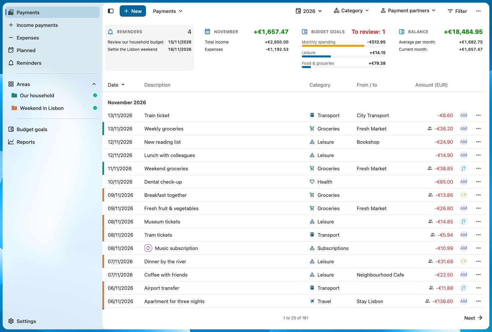
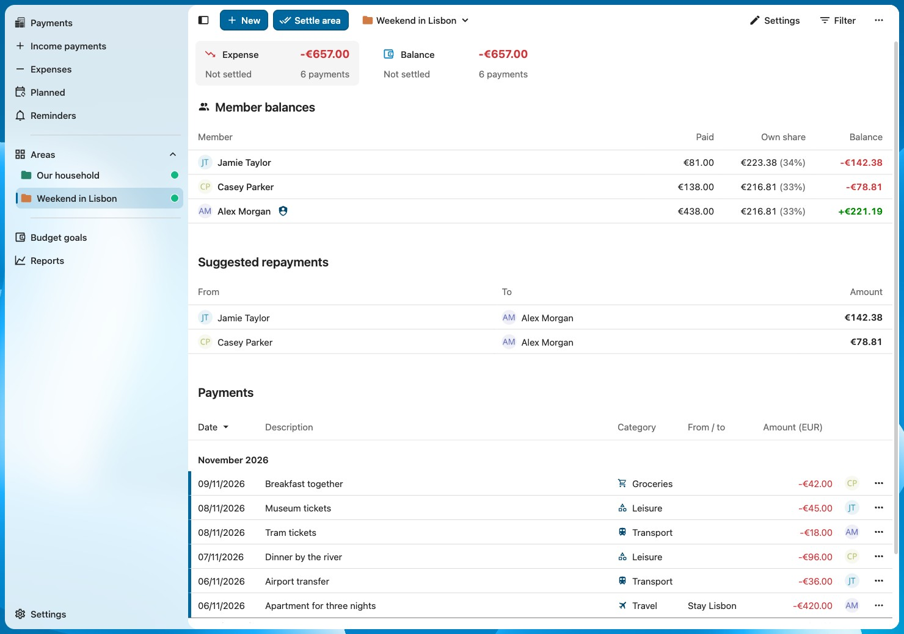
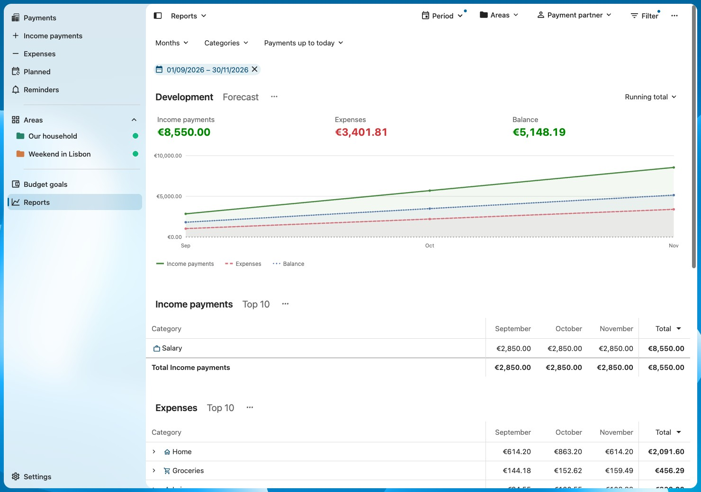
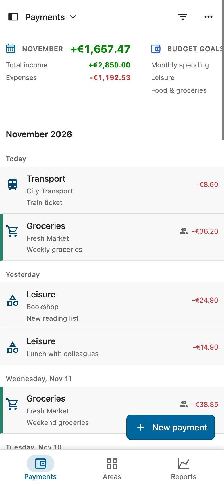
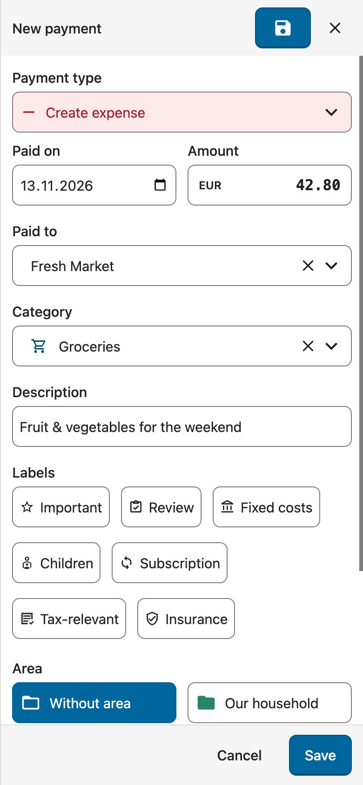

# CoBudget

[English](../README.md) · [Deutsch](readme.de.md) · [Français](readme.fr.md) · **Español**

CoBudget combina un presupuesto personal con áreas compartidas en Nextcloud.
Registras ingresos y gastos y, para los pagos compartidos, indicas quién pagó y
cómo se reparte el importe. Tu vista personal incluye tu parte; el área compartida
muestra el pago completo y cuánto se deben los miembros entre sí.

La aplicación web también está adaptada a móviles y tabletas. Así puedes registrar pagos directamente cuando estás fuera de casa.

CoBudget no se conecta a cuentas bancarias. Los informes se basan en los pagos
que registras.

[Cómo funcionan los pagos y las partes individuales](concept.md).

## Funciones

- **Pagos:** ingresos y gastos con categorías, destinatarios de pagos,
  etiquetas y tags.
- **Planificación:** pagos recurrentes, objetivos de presupuesto, informes,
  comparaciones y previsiones.
- **Áreas compartidas:** indica quién pagó, elige el reparto y liquida los saldos
  pendientes. Tu vista personal contabiliza tu parte; el área compartida muestra
  el importe total.
- **Justificantes y recordatorios:** justificantes en Nextcloud Files y recordatorios
  independientes o vinculados a pagos, que puedes completar y archivar.
- **Notificaciones:** Nextcloud, un chat privado de CoBudget en Talk y
  correo electrónico opcional, por separado según el evento. Los recordatorios
  también se sincronizan con un calendario; los cambios en calendarios privados
  se reflejan en CoBudget.
- **API externa (beta)** para integraciones con claves personales por espacio de trabajo y permisos separados para los pagos personales y cada área. Una vez que un administrador de Nextcloud active la API, puedes crear tus claves en los ajustes de CoBudget. [Configuración y referencia de la API (inglés)](api.md)
- **[Importación de pagos](payment-imports.es.md):** opcionalmente, importar pagos en formato JSON manualmente con vista previa o automáticamente desde una carpeta de Nextcloud.
- **Exportaciones y copias de seguridad:** imprimir informes, exportar en CSV, copiar tablas a una hoja de cálculo y crear exportaciones personales o copias de seguridad de administrador.
- **Espacios de trabajo y apariencia:** conjuntos de datos separados mediante espacios de
  trabajo, vistas para móvil y escritorio y temas claro, oscuro o del sistema.
- **Idiomas de la interfaz:** inglés, alemán, francés y español.

La documentación técnica adicional está en inglés:
[funciones](../FEATURES.md), [cálculos de los informes](reports.md) y
[concepto de CoBudget](concept.md).

## Capturas de pantalla

CoBudget 1.0 con datos ficticios. Haz clic en una imagen para ampliarla.

<table>
<tr>
<td width="50%" align="center" valign="top">
<strong>Pagos y partes individuales</strong> 

</td>
<td width="50%" align="center" valign="top">
<strong>Gastos compartidos y reembolsos</strong> 

</td>
</tr>
<tr>
<td width="50%" align="center" valign="top">
<strong>Informes</strong> 

</td>
<td width="50%" align="center" valign="top">
<strong>Registro de pagos en el móvil</strong> 

</td>
</tr>
</table>

## Requisitos

CoBudget requiere **Nextcloud 34 o posterior**.

Usa una versión de PHP compatible con tu Nextcloud (8.2 o posterior para 34,
8.3 o posterior para 35), un navegador moderno y tareas en segundo plano operativas.
Talk, calendario y correo son opcionales. Los correos se envían a la dirección de
la cuenta de Nextcloud; el servidor debe tener configurado el envío de correo.

## Instalación y actualizaciones

Instala CoBudget desde la administración de aplicaciones de Nextcloud a través de
la [App Store](https://apps.nextcloud.com/apps/cobudget), o usa
`occ app:install cobudget`. Para instalar manualmente:

1. Descarga el archivo firmado `cobudget.tar.gz` de las [publicaciones de GitHub](https://github.com/whollaus/cobudget/releases).
2. Extráelo en `apps/` o `custom_apps/` de Nextcloud, con el nombre de carpeta `cobudget`.
3. Activa la aplicación y completa cualquier actualización pendiente.

Los archivos de código fuente que GitHub genera automáticamente no son paquetes
instalables. Haz una copia de seguridad antes de actualizar. Configura `cron.php`
para que se ejecute cada cinco minutos como usuario del servidor web.
Consulta la [guía de administración](operations.md).

## ¿Qué incluye una copia de seguridad?

Una **exportación personal** conserva tu perspectiva financiera y solo se puede
importar en una cuenta sin datos de CoBudget. Las partes de gastos compartidos se
convierten en pagos personales independientes. Una **copia completa de
administrador** contiene los datos financieros de todos los usuarios de CoBudget
y sus preferencias transferibles. Al restaurarla, se reemplazan los datos actuales
de la aplicación.

**Incluye los justificantes en tu copia de Nextcloud Files.** Las copias de CoBudget contienen sus referencias. Si mueves el archivo o recuperas una copia antigua o de otra instancia, puede que debas adjuntarlo de nuevo. Conserva una copia completa de Nextcloud para poder recuperar el servidor.
CoBudget bloquea temporalmente el
acceso a la aplicación durante las copias y restauraciones. Si hay una operación
en curso, vuelve a intentarlo cuando termine. Recarga las pestañas abiertas de
CoBudget después de una restauración. Consulta el
[procedimiento de recuperación](operations.md#backup-and-recovery).

## Comentarios y apoyo

Los informes de errores y los resultados de pruebas ayudan a mejorar CoBudget. CoBudget se mantiene principalmente por una persona; acuerda antes
las contribuciones de código.
[GitHub Issues](https://github.com/whollaus/cobudget/issues) · [Colaborar](../CONTRIBUTING.md) ·
[Cambios](../CHANGELOG.md) · [Comunicar una vulnerabilidad](../SECURITY.md).

Apoya el desarrollo en [GitHub Sponsors](https://github.com/sponsors/whollaus)
o [Stripe](https://donate.stripe.com/aFaeVdfARbPNe897bu5J600).
Licencia: [AGPL-3.0 o posterior](../LICENSE).
