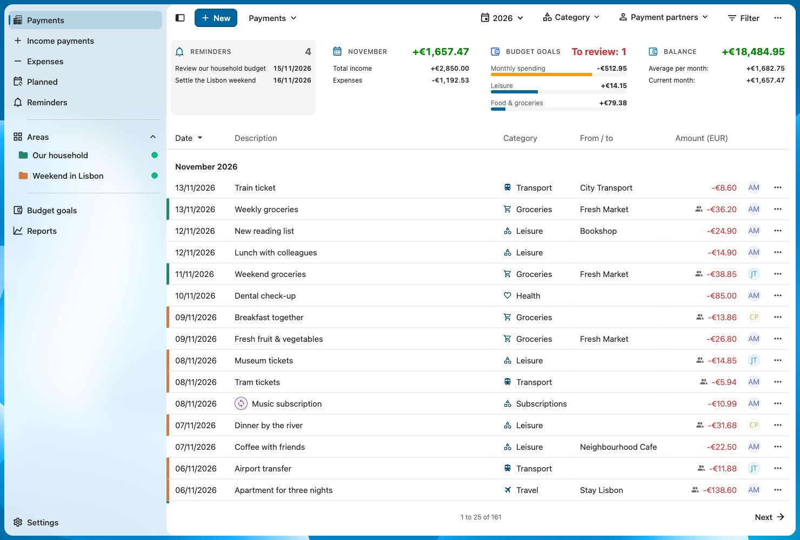
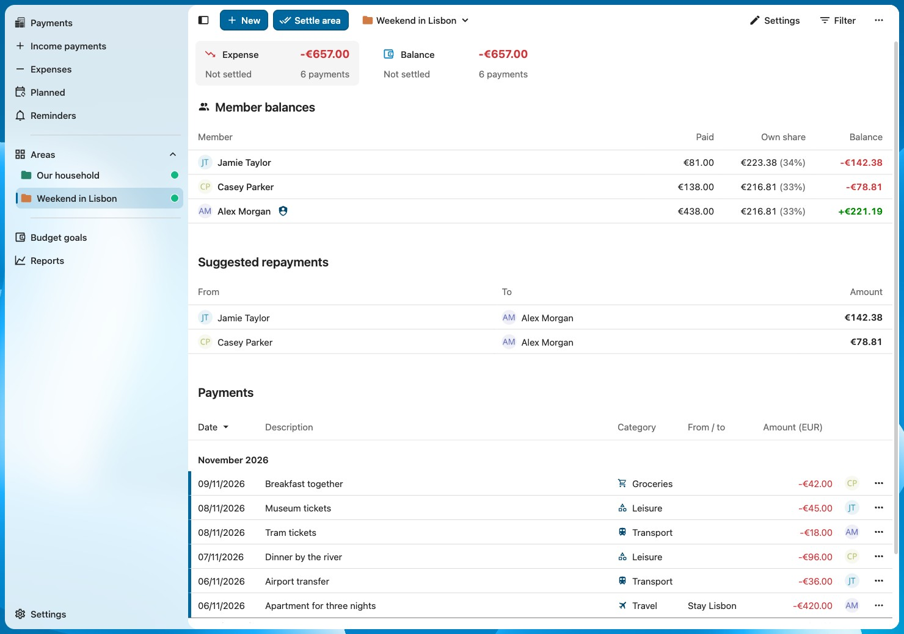
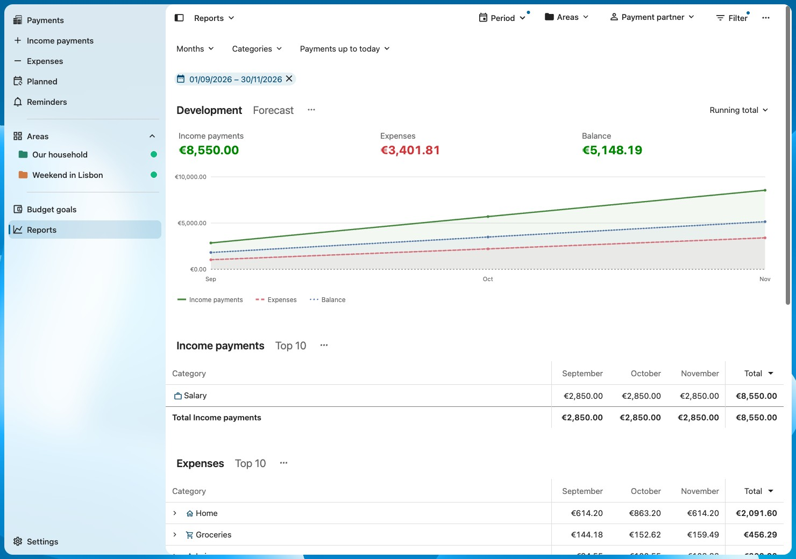
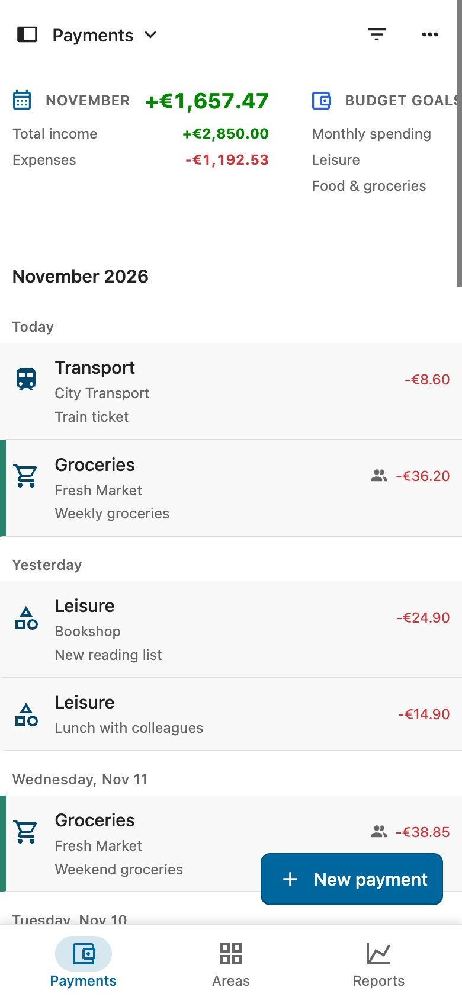
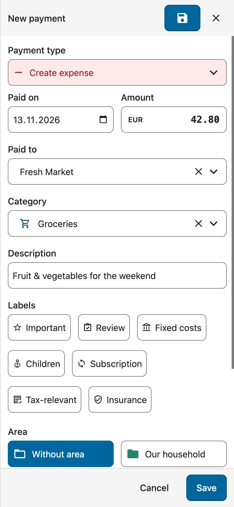

# CoBudget

[English](../README.md) · [Deutsch](readme.de.md) · **Français** · [Español](readme.es.md)

CoBudget réunit un budget personnel et des espaces partagés dans Nextcloud.
Vous enregistrez vos revenus et dépenses et, pour les paiements partagés, indiquez
qui a payé et comment répartir le montant. Votre vue personnelle tient compte de
votre part ; l’espace partagé affiche le paiement complet et les sommes dues
entre membres.

L’application web est également adaptée aux smartphones et aux tablettes. Vous pouvez ainsi enregistrer vos paiements lors de vos déplacements.

CoBudget ne se connecte pas aux comptes bancaires. Les rapports reposent sur les
paiements que vous enregistrez.

[Fonctionnement des paiements et des parts](concept.md).

## Fonctionnalités

- **Paiements :** revenus et dépenses, catégories, partenaires de paiement,
  libellés et tags.
- **Planification :** paiements récurrents, objectifs budgétaires, rapports, comparaisons
  et prévisions.
- **Espaces partagés :** indiquez qui a payé, choisissez la répartition et
  soldez les comptes. Votre vue personnelle compte votre part ; l’espace partagé
  affiche le montant total.
- **Justificatifs et rappels :** justificatifs dans Nextcloud Files et rappels autonomes
  ou liés à un paiement, avec suivi de leur réalisation et archivage.
- **Notifications :** Nextcloud, conversation privée CoBudget dans Talk
  et e-mail facultatif, activables séparément selon l’événement. Les rappels peuvent
  aussi être synchronisés avec un calendrier ; les modifications d’un calendrier
  privé sont répercutées dans CoBudget.
- **[Import de paiements](payment-imports.fr.md) :** en option, importer des paiements au format JSON manuellement avec un aperçu ou automatiquement depuis un dossier Nextcloud.
- **Exports et sauvegardes :** imprimer des rapports, exporter en CSV, copier des tableaux dans un tableur et créer des exports personnels ou des sauvegardes administrateur.
- **Espaces de travail et affichage :** jeux de données séparés grâce aux espaces de travail,
  affichage mobile ou bureau et thème clair, sombre ou système.
- **Langues de l’interface :** anglais, allemand, français et espagnol.

La documentation technique complémentaire est en anglais :
[fonctionnalités](../FEATURES.md), [calcul des rapports](reports.md) et
[concept de CoBudget](concept.md).

## Captures d’écran

CoBudget 1.0 avec des données fictives. Cliquez sur une image pour l’agrandir.

<table>
<tr>
<td width="50%" align="center" valign="top">
<strong>Paiements et parts personnelles</strong> 

</td>
<td width="50%" align="center" valign="top">
<strong>Dépenses partagées et remboursements</strong> 

</td>
</tr>
<tr>
<td width="50%" align="center" valign="top">
<strong>Rapports</strong> 

</td>
<td width="50%" align="center" valign="top">
<strong>Saisie d’un paiement sur mobile</strong> 

</td>
</tr>
</table>

## Prérequis

CoBudget nécessite **Nextcloud 34 ou une version ultérieure**.

Utilisez une version de PHP compatible avec votre Nextcloud (8.2 minimum pour
34, 8.3 pour 35), un navigateur récent et des tâches de fond fonctionnelles.
Talk, le calendrier et l’e-mail sont facultatifs. Les e-mails utilisent l’adresse
du compte Nextcloud ; l’envoi de courrier doit être configuré sur le serveur.

## Installation et mises à jour

Installez CoBudget depuis la gestion des applications de Nextcloud via
l’[App Store](https://apps.nextcloud.com/apps/cobudget), ou utilisez
`occ app:install cobudget`. Pour une installation manuelle :

1. Téléchargez le fichier signé `cobudget.tar.gz` depuis les [versions GitHub](https://github.com/whollaus/cobudget/releases).
2. Extrayez-le dans `apps/` ou `custom_apps/`, sous le nom de dossier `cobudget`.
3. Activez l’application et terminez toute mise à jour en attente.

Les archives de code source générées automatiquement par GitHub ne sont pas des
paquets installables. Sauvegardez avant toute mise à jour. Exécutez `cron.php`
toutes les cinq minutes avec le compte du serveur web. Voir le
[guide d’exploitation](operations.md).

## Que contient une sauvegarde ?

Un **export personnel** conserve votre propre perspective financière. Il ne peut
être importé que dans un compte sans données CoBudget ; les parts communes
deviennent des paiements personnels indépendants. Une **sauvegarde complète
administrateur** contient les données financières de tous les utilisateurs de
CoBudget et leurs paramètres transférables. Sa restauration remplace les données
actuelles de l’application.

**Les fichiers justificatifs ne sont pas inclus : seuls leurs chemins sont
conservés.** Utilisez votre solution de sauvegarde habituelle pour Nextcloud Files
pour protéger ces fichiers. Cette responsabilité reste volontairement séparée.
Ces archives ne remplacent pas une sauvegarde complète de Nextcloud. CoBudget
bloque temporairement l’accès à l’application pendant la sauvegarde et la
restauration. Si une opération est en cours, réessayez après sa fin. Rechargez
les onglets CoBudget ouverts après une restauration. Voir la
[procédure de restauration](operations.md#backup-and-recovery).

## Retours et soutien

Les signalements de bugs et les résultats de tests contribuent à améliorer CoBudget. CoBudget est principalement maintenu par une personne ; discutez
au préalable des contributions de code.
[GitHub Issues](https://github.com/whollaus/cobudget/issues) · [Contribuer](../CONTRIBUTING.md) ·
[Historique](../CHANGELOG.md) · [Signaler une vulnérabilité](../SECURITY.md).

Soutenez le développement sur [GitHub Sponsors](https://github.com/sponsors/whollaus)
ou [Stripe](https://donate.stripe.com/aFaeVdfARbPNe897bu5J600).
Licence : [AGPL-3.0 ou ultérieure](../LICENSE).
